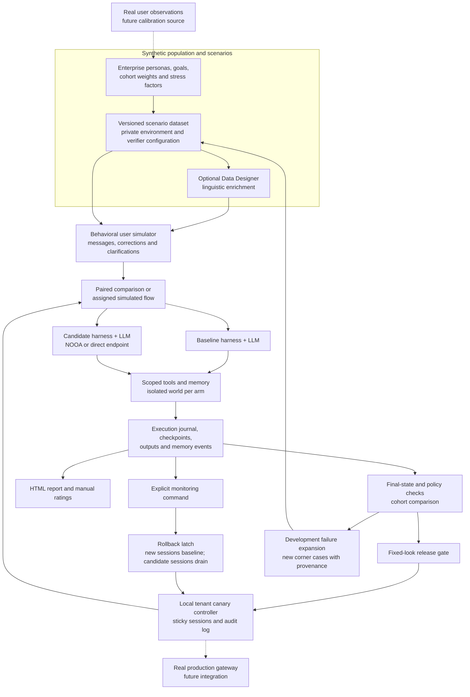

# sim_engine_ux_agent

A synthetic-data-powered simulation engine for a fictional enterprise service-desk agent.
It exercises the complete loop: **population -> scenarios -> old/new agent runs -> evidence
and ratings -> release gates -> tenant canary -> rollback -> new corner cases**.

The worked use case is **workspace access restoration across sessions**. A user first
sets a notification preference, then returns to request access. Between sessions, the
preference may change, authorization may be revoked, or a stale memory may suggest
privileges the user no longer has. Tools can return hostile text or time out after a
successful write. The agent must achieve a correct final state without duplicate actions.

This repository was authored without installing dependencies, building an environment,
running tests, or executing the workflow. Run and review it on your remote machine.
It is a research prototype with fictional data, not a verified production integration.

## Design intent and discussion summary

The starting point was a hand-drawn lifecycle: observe users interacting with an old
agentic system, simulate that population and its use cases, compare a new system,
move a controlled percentage of user flows, and continuously collect evidence for
rollback, optimization, and corner-case exploration. This repository turns that
idea into a concrete, manually runnable research prototype.

The proposed pattern is **simulation-driven agent lifecycle management**. The unit
under evaluation is the complete **harness + LLM + prompts + tools + knowledge +
state/memory + policies**, anchored in a specific use case. A model-only benchmark
cannot establish whether that full combination works for its users.

### Architecture

The diagram shows the implemented laboratory and the production connections it is
intended to support. Dashed connections are future integration paths. Every comparison
arm receives its own environment and memory; the tools box represents a common
contract, not a shared mutable database.



See [the detailed architecture](docs/architecture.md) for contracts, evidence layout,
memory conversion, and production extension points.

### What simulation means here

Synthetic data defines the starting conditions; simulation executes interactions
over time. A useful episode combines **persona + goal + interaction behavior +
initial state/memory + tool environment + disturbances + success criteria**.
Enterprise roles, permissions, expertise, language, and workflow frequency matter
alongside demographic diversity. Population-grounded personas alone do not establish
representativeness for a particular enterprise application.

The discussion led to three separate evaluation collections:

| Collection | Purpose |
|---|---|
| Representative scenarios | Estimate behavior under a calibrated production task/cohort mix |
| Stress and corner cases | Oversample rare failures, permissions conflicts, interruptions, stale memory, and tool faults |
| Held-out regression tasks | Assess changes independently of the examples used for optimization |

The current simulator uses reproducible behavioral rules and optional generated
paraphrases. It does not claim to reproduce a real user population. Its holdout split
uses separate random streams but shares templates; stronger independent evaluation
requires novel held-out tasks and calibration against real observations.

### Evidence to collect continuously

Link each interaction to its user/tenant scope, cohort, experiment assignment,
system version, and eventual outcome. Collect outputs and ratings together with
model/tool calls, retrieval evidence where available, retries, failures, state
transitions, memory reads/writes, checkpoints, latency, tokens, cost, and dataset
lineage. Keep **synthetic versus real observations** and **proxy versus human ratings**
explicitly distinguishable.

The prototype implements the relevant subset through JSONL journals, manifests,
snapshots, deterministic checks, manual reviews, and native NOOA journals. Retrieval
instrumentation, production feedback ingestion, and a unified cross-framework trace
export remain extension work. NOOA token/cost aggregation is not implemented here.

For reasoning visibility, record observable execution and whatever reasoning fields
or summaries a model explicitly exposes. Hidden internal reasoning may be unavailable;
an exposed explanation is not proof of the model's causal process. Operational memory
and the telemetry archive serve different purposes: evidence should become memory or
training data only through an explicit selection process with suitable access,
redaction, and retention controls.

### Migration and rollout strategy

The intended lifecycle is **baseline instrumentation -> offline paired evaluation ->
shadow evaluation -> canary -> progressive expansion -> full migration**, with evidence
feeding back into scenario generation throughout. An illustrative exposure sequence
is 1%, 5%, 20%, 50%, and 100%; actual thresholds and observation windows depend on risk,
traffic volume, cohort coverage, and statistical power.

Use stable user/tenant assignment when memory spans sessions. Predefine task-success
criteria, acceptable regressions, policy limits, latency/cost budgets, sample sizes,
and stop rules. Evaluate important cohorts separately. Paired simulation runs should
start from equivalent state, while allowing later conversation turns to respond to
each system's behavior. Historical replay answers narrower questions than interactive
simulation. Shadow writes and external actions must stay isolated.

Memory/schema migration is a separate experiment: preserve scope and provenance,
test cold and migrated starts, and establish backward compatibility. A traffic rollback
cannot undo an external action or incompatible state write; recovery may require
reconciliation or compensating actions. This lab converts simple fact schemas and
drains existing candidate sessions after rollback. It does not migrate model KV caches
or embeddings, run a real gateway, or implement a production shadow deployment.

### How the research informed the worked use case

The research themes from our discussion were translated into general design choices:
separate scenario/task/environment/verifier stages; track dataset provenance and
quality gates; measure the complete agent combination; isolate persistent state;
make memory useful to a later task; and validate judges/verifiers themselves.

The fictional service-desk journey makes those themes observable. Session 1 saves a
notification preference. Session 2 requests workspace access after a possible
preference correction or permission change. The candidate must clarify ambiguity,
consult current policy, preserve memory continuity, and recover from a timeout after
a committed write without creating duplicates. Final grants and notifications provide
concrete verification targets. See [the use-case specification](docs/use-case.md).

Deterministic state/policy checks are the primary oracle here. Human ratings are stored
separately for qualitative UX review. Future LLM judges need calibration and checks for
disagreement or overfitting to one reference solution. A successful memory read/write
integration alone does not establish that an agent writes useful memories or applies
retrieved facts correctly.

### NVIDIA capability map and NOOA decision

These roles summarize the research assessment recorded on **2026-11-16**. They are
architectural mappings; an entry does not imply an implemented SDK integration or
a single NVIDIA service covering the entire lifecycle.

| Component | Role in the proposed architecture | Status in this repository |
|---|---|---|
| NeMo Data Designer | Structured synthetic scenario data, correlated attributes, validation, and generation workflows | Optional linguistic-enrichment script; core scenario generation is local |
| NeMo User Sim / Nemotron-Personas | Population-grounded multi-turn simulated users | Extension path; current users follow a behavioral state machine |
| NeMo Gym | Stateful rollout execution, environments, and verifiers | Extension path; the public Gym documentation includes User Sim integration |
| NeMo Agent Memory evaluation/dataset work | Memory-dependent tasks, generated environments, verifiers, and benchmark provenance | Design influence; no production memory-service dependency |
| NOOA | Typed agent methods, harness execution, and native tracing | Optional `Agent` + `PredictStrategy` adapter returning typed actions |
| NeMo Relay | Runtime instrumentation, middleware, and telemetry export | Extension path |
| NeMo Helix | Evaluation, optimization, and hardening orchestration | Extension path |
| NeMo Fabric | Consistent interfaces across harnesses and custom agents | Extension path |

**NOOA is a suitable harness to evaluate in this architecture.** Application-owned
tools enforce permissions, while NOOA plans typed actions. This keeps the simulator,
memory migration, verifier, and release controller comparable across harnesses. The
adapter does not exercise NOOA CodeAct or its memory plugin, and it does not establish
that NOOA is universally better than another harness. Compare harnesses using the
same model, policy, tasks, and initial state before changing multiple variables.

The assessed NeMo Agent Memory work supports a memory evaluation/dataset role; the
research did not establish it as the enterprise knowledge-ingestion or production
memory service to embed in this application. Similarly, the public Agent Toolkit
migration guidance reviewed during authoring points toward Relay, Helix, and Fabric
for the corresponding capabilities, so this prototype introduces no Agent Toolkit
dependency.

The [NVIDIA integration assessment and public sources](docs/nooa-and-nvidia.md)
provide supporting references. This summary preserves the architectural conclusions
from the discussion without embedding internal message transcripts, employee details,
or private datasets in the repository. All optional integrations remain unexecuted
until reviewed and run on the target machine.

## Start on Linux or WSL 2

Use Python 3.12 or 3.13. Commands below assume the repository root and a new output
directory for each run. The rules backend needs no model credentials.

```bash
python3.12 -m venv .venv
source .venv/bin/activate
python -m pip install -e .

sim-engine generate --count 128 --suite stress --out artifacts/stress.jsonl
sim-engine compare --scenarios artifacts/stress.jsonl --out artifacts/rules-comparison
sim-engine gate --run artifacts/rules-comparison
sim-engine report --run artifacts/rules-comparison
```

Open `artifacts/rules-comparison/report.html`. A gate exit code of **2** means **hold**,
not a CLI execution failure. Run the report command separately even when the gate holds.
Small samples, sparse cohorts, and the conservative interval can legitimately hold.
The rules baseline has deliberately documented defects; its results are demonstrations,
not measured NVIDIA model performance.

For a representative sample and a separately labeled holdout:

```bash
sim-engine generate --count 1000 --suite representative --split development --out artifacts/development.jsonl
sim-engine generate --count 1000 --suite representative --split holdout --seed 99 --out artifacts/holdout.jsonl
sim-engine compare --scenarios artifacts/holdout.jsonl --out artifacts/holdout-comparison
sim-engine gate --run artifacts/holdout-comparison
```

The population weights and event rates in `configs/population.json` are illustrative.
Replace them with approved aggregate observations before making representativeness claims.
Development and holdout use separate random streams; they still share scenario templates.
For a true independent holdout, keep novel tasks and domain knowledge outside development.

## Use an actual LLM

`openai-compatible` uses a Chat Completions endpoint, including compatible NIM/vLLM
services. It requests JSON output; choose an endpoint that supports `response_format`.

```bash
cp .env.example .env
# Edit .env with an available model and endpoint, then export it in your shell:
set -a
source .env
set +a

sim-engine generate --count 8 --suite stress --out artifacts/llm-smoke-inputs.jsonl
sim-engine compare --scenarios artifacts/llm-smoke-inputs.jsonl \
  --candidate-backend openai-compatible --out artifacts/llm-comparison
sim-engine report --run artifacts/llm-comparison
```

`.env` is not loaded by the Python code. Never commit keys. These commands call the
configured inference endpoint and may incur cost. Unknown pricing is reported as null.
Request/response bodies in local evidence contain synthetic conversation content.

To compare two model endpoints, set optional overrides such as
`SIM_BASELINE_LLM_MODEL`, `SIM_CANDIDATE_LLM_MODEL`,
`SIM_BASELINE_LLM_BASE_URL`, `SIM_CANDIDATE_LLM_BASE_URL`, and the corresponding
`..._API_KEY` variables. Set both backends to `openai-compatible`. Without overrides,
both use the shared `SIM_LLM_*` settings. The shared policy prompt stays the same.

## Use NOOA as the candidate harness

NOOA is a good fit for the **agent execution/decision layer**. This adapter uses
`Agent` + `PredictStrategy` with a typed `Action` return value. Application code
executes allowlisted tools, enforces authorization, and collects comparable evidence.
NOOA does not replace the population simulator, release experiment, or memory migration.

```bash
python -m pip install -e '.[nooa]'
nooa connect
# Configure a model alias named service-desk using your chosen provider.
export SIM_NOOA_MODEL=service-desk
sim-engine compare --scenarios artifacts/llm-smoke-inputs.jsonl \
  --candidate-backend nooa --out artifacts/nooa-comparison
sim-engine report --run artifacts/nooa-comparison
```

Variant-specific NOOA aliases are `SIM_BASELINE_NOOA_MODEL` and
`SIM_CANDIDATE_NOOA_MODEL`. Native traces are written into each episode's
`nooa-journal/` directory; this adapter does not aggregate their token usage/cost.
The normal JSONL journal remains available independently. NOOA is evolving research
software; resolve and pin a compatible release on your remote machine after inspection.
See [the fit assessment](docs/nooa-and-nvidia.md) for boundaries and extension paths.

## Exercise the local canary and rollback

The controller persists tenant hashing, session assignments, and an audit log in SQLite.
A passing comparison gate is required to increase local exposure. If your gate holds,
investigate and collect more evidence instead of editing the decision to pass.

```bash
sim-engine rollout --db artifacts/rollout.sqlite init --experiment desk-v2 --salt fixed-demo-salt
sim-engine rollout --db artifacts/rollout.sqlite set-percent --percent 5 --gate artifacts/rules-comparison/gate.json
sim-engine traffic --db artifacts/rollout.sqlite --scenarios artifacts/stress.jsonl --out artifacts/canary-05
sim-engine report --run artifacts/canary-05
sim-engine monitor --db artifacts/rollout.sqlite --run artifacts/canary-05 --apply-rollback
```

`traffic` actually executes the assigned **simulated** flows; it does not touch a real
gateway. Each scenario contains a complete two-session flow, with isolated memory and
environment. Candidate flows migrate legacy memory between sessions. Routing percentages
are percentages of tenant hash space; small populations will not match them exactly.
Repeated traffic replays reuse the same synthetic session identities. Generate fresh
scenarios for new sessions, and keep the same database for the same experiment.

You can inspect an assignment or latch a rollback manually:

```bash
sim-engine rollout --db artifacts/rollout.sqlite route --tenant example-tenant --session new-session
sim-engine rollout --db artifacts/rollout.sqlite rollback --reason 'Observed permission regression'
```

After rollback, new sessions use baseline; existing candidate sessions return **drain**.
The controller refuses further ramping in that database. Reconcile state and start a new
experiment after investigating. It never silently switches an in-flight session's schema.
Monitoring evaluates already collected evidence; it is an explicit command, not a daemon.

## Close the feedback loop

```bash
sim-engine expand-failures --scenarios artifacts/llm-smoke-inputs.jsonl \
  --run artifacts/llm-comparison --out artifacts/failure-corners.jsonl
```

Use the exact scenario dataset that produced the run. Expansion flips one stress
factor at a time, records parent provenance, and excludes
holdout failures. No failures can produce an empty dataset; generate more tasks rather
than trying to evaluate an empty file.

```bash
sim-engine rate --run artifacts/nooa-comparison \
  --scenario development-stress-42-000000 --variant candidate --rating 3 \
  --comment 'Correct final outcome, but the clarification was confusing.'
```

Ratings go to `human-reviews.jsonl` alongside episode identity. The dashboard's
`user_rating_proxy` remains clearly separate from human feedback. Human reviews are
stored for analysis and are not silently substituted into automated release gates.

Optional Data Designer linguistic variation, with the `nvidia-text` alias configured:

```bash
python -m pip install -e '.[sdg]'
export NVIDIA_API_KEY='supply-your-key-in-your-shell'
python scripts/enrich_with_data_designer.py --input artifacts/stress.jsonl --out artifacts/paraphrases.jsonl
sim-engine compare --scenarios artifacts/paraphrases.jsonl \
  --candidate-backend openai-compatible --out artifacts/paraphrase-comparison
```

Review paraphrase semantics first. The script checks preservation of key task tokens;
that structural check cannot prove that the original meaning survived generation.

## Repository map

| Location | Purpose |
|---|---|
| `src/sim_engine/contracts.py` | Versioned scenario, action, and evidence contracts |
| `scenarios.py`, `world.py` | Population sampling, behavioral user state machine, stateful tools |
| `agents.py` | Engineered old/new baselines, direct endpoint adapter, NOOA adapter |
| `memory.py`, `runner.py` | Scoped memory migration and isolated paired execution |
| `evaluation.py` | Final-state checks, cohort metrics, fixed-look release gate |
| `rollout.py`, `traffic.py` | Local canary assignments, simulated routed execution, rollback latch |
| `feedback.py`, `report.py` | Failure expansion and filterable portable report |
| `docs/use-case.md` | Narrative, scenario matrix, and acceptance criteria |
| `docs/architecture.md` | Contracts, evidence flow, and production boundaries |
| `docs/nooa-and-nvidia.md` | NVIDIA capability map, sources, and integration maturity |
| `tests/test_invariants.py` | Manual remote checks for authorization, idempotency, migration, rollback |

Manual checks, if desired: `python -m pip install -e '.[dev]'` then `pytest`.
No build or runtime validation was performed when creating this codebase.
