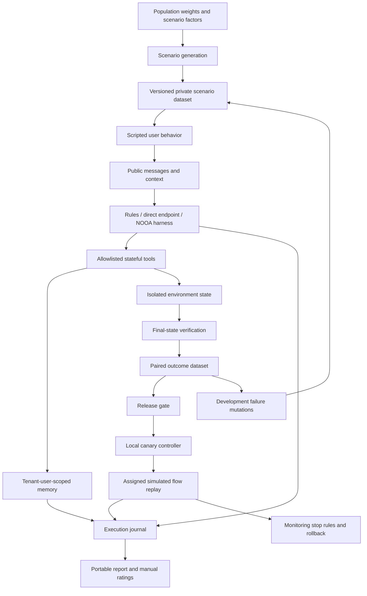

# Architecture and evidence contract



## Main contracts

`Scenario` is a private simulator/verifier record. `Persona` supplies fictional
identity, enterprise role, locale, expertise, and patience. Scenario flags configure
the environment; they are not part of the agent context.

`World.public_context()` exposes only authenticated identity, current session number,
and tool argument contracts. The agent sees the current user message and subsequent
tool results. The second session has a fresh conversation history: memory must be
retrieved explicitly. The world changes only through application-owned tool methods.

`Action` is a typed tool name plus JSON arguments. Tools reject unknown names and
unexpected argument keys. The implementation is deliberately not a generic remote
code executor. Generated action JSON cannot directly invoke filesystem or shell tools.

The memory scope is `(tenant, user, run/scenario/variant namespace)`. No mutable
World or Memory instance is shared across comparison arms. A real backend should
enforce scope server-side, not trust model-provided tenant identifiers.

## Memory migration and recovery

v1 stores flat fact values. v2 stores `{value, source, revision}`. Migration preserves
fact values and scope; v2 -> v1 drops metadata. It is a semantic conversion, not a
byte-for-byte archival restore. Never use it to convert embedding or model KV caches.

The paired runner writes pre/post-migration snapshots and checkpoints. In migrated
candidate mode, session 1 always uses the legacy rules harness and v1 memory; session 2
uses the configured candidate backend and v2 memory. Thus this mode measures a
specific legacy-to-candidate continuity scenario. Use `--migration-mode cold` to
exercise the configured backend in both sessions. The baseline always uses v1.

To inspect conversion manually, use explicit, different source/destination paths:

```bash
sim-engine migrate-memory --snapshot path/to/post-migration-memory.json --to 1 --out artifacts/restored-v1.json
```

Production recovery additionally needs a canonical event log, concurrency/version
checks, write fences, schema compatibility policy, and reconciliation for writes made
after migration. Rolling back traffic cannot unsend a message or undo an external
grant. The local controller uses `drain` for existing candidate sessions after rollback,
leaving the application responsible for safe termination or completion.

## Evidence layout

```text
artifacts/<run>/
  manifest.json
  outcomes.jsonl
  summary.json
  gate.json                    # created by gate
  monitor.json                 # created by monitor
  report.html                  # created by report
  human-reviews.jsonl           # appended by rate
  episodes/<scenario>/<variant>/
    events.jsonl
    final-state.json
    outcome.json
    pre-migration-memory.json  # migrated candidate only
    post-migration-memory.json
    nooa-journal/              # NOOA backend only
```

Every event has a schema, UTC timestamp, sequence, run/scenario/variant identity,
and applicable user/tenant/session identity. Tool events include arguments/results
and before/after state digests. State checkpoints and memory events enable diagnosis.
This custom journal is not claimed to conform to OpenTelemetry or ATIF. NOOA's
native journal preserves its own detailed traces. Future export should retain both
application correlation IDs and framework span identity.

Direct endpoint requests/responses and provider-reported token counts are recorded.
The direct adapter uses `AsyncOpenAI` with the NVIDIA endpoint/model configured in
`.env`; the standalone inference example uses `OpenAI`. Both use Chat Completions.
Local dotenv loading preserves exported shell variables. Requests default to
`max_tokens=512` and omit `response_format`/`temperature` unless configured.
Credentials/Authorization headers are not recorded. Pricing is operator supplied;
NOOA token/cost aggregation is unavailable in this adapter and remains null rather
than being presented as free. No system can promise access to hidden model reasoning.
This lab records only exposed model output and observable execution.

Output directories must be new for each paired run; retries do not silently append
duplicate observations to an existing comparison. The code is sequential by design.
Journal files are not a concurrent production log service.

## Evaluation boundaries

The verifier checks final effects and required policy behavior rather than comparing
against one exact action trace. Tool enforcement is independent of the verifier:
an agent that tries an unauthorized grant fails the safety check even if no mutation
gets through. Infra/model exceptions remain failed observations; they are not dropped.

The gate requires complete pairs, minimum samples overall/per observed cohort,
no unacceptable candidate safety/errors, and configured latency/cost limits. It
uses a one-sided Hoeffding lower bound on paired binary-success differences with
Bonferroni correction across overall and observed cohort comparisons. This is
deliberately conservative and intended for one fixed analysis of a planned dataset.
The mathematical sample bound assumes independent draws. Factorial stress runs are
coverage exercises; their intervals should not be interpreted as population inference.

The gate does not infer real-population guarantees from synthetic data. It also
does not detect cohorts absent from the dataset: use the population manifest and
coverage review before deployment. Repeatedly looking and promoting when a score
passes invalidates a fixed-look inference. For real traffic use a preplanned
experiment or an appropriate sequential method with tenant clustering accounted for.

The monitor's stop rules are operational: any candidate authorization attempt or
execution error can trigger rollback; the minimum success floor applies after a
specified count. They are not statistical promotion rules. `--apply-rollback` changes
only the local SQLite controller, and must be explicitly supplied.

## Production extension points

1. Replace scripted users with a calibrated User Sim domain/probe while preserving
   the private oracle/public-context separation.
2. Wrap real tools behind a shadow-safe sandbox, server-owned identity and scope,
   idempotency, and action authorization.
3. Add an approved production event source and derive aggregate cohort distributions.
4. Connect runtime tracing via Relay/OTel and provide explicit retention/redaction.
5. Connect the router decision to a gateway at session boundaries; add a schema-aware
   transition service and capacity monitoring.
6. Add human review and independently calibrated judges for qualitative UX dimensions.
7. Add held-out novel tasks and adversarial environments, not only more paraphrases.

Live traffic splitting, real tool mutations, production memory services, background
monitoring daemons, and NVIDIA deployment orchestration are outside this implementation.
