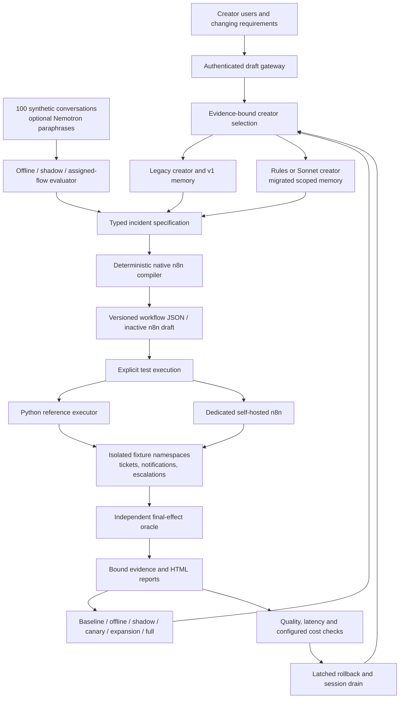
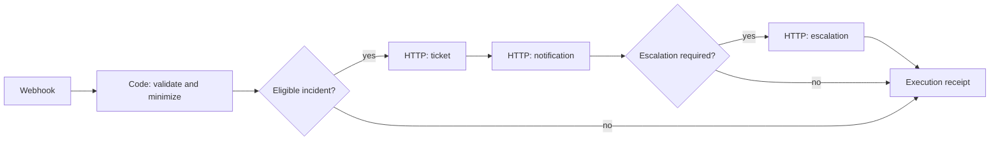

# Enterprise workflow creator: self-hosted n8n

This is the second domain in the simulation engine. The first service-desk domain
remains available as `sim-engine`; the workflow-creation domain uses **`n8n-lab`**.
The new domain implements a real-world authoring pattern with fixture-backed business
services and an actual self-hosted n8n execution adapter. Reference results alone
are never presented as proof of n8n execution or real enterprise readiness.

## The use case

An operations owner requests an automation that creates incident tickets, routes
notifications, avoids duplicate actions and escalates critical incidents. A later
conversation changes the severity threshold, EU channel and acknowledgement rule.
The creator must remember the existing project/default channel, clarify an unnamed
new destination and apply current requirements instead of stale memories.

The model authors a typed specification. A deterministic compiler produces native
n8n workflow JSON. This first workflow family supports:

- Severity thresholds with exact boundary checks.
- Separate EU and default notification channels from a tenant catalog.
- Duplicate event delivery and idempotent ticket/message/escalation effects.
- Retry after a ticket commits but returns HTTP 503; notification failure before write.
- Acknowledgement-gated critical escalation, using a boolean in each event fixture.
- Downstream removal of personal fields, malformed input rejection and tenant binding.
- Hostile alert text treated as data, never instructions or generated executable code.

Ticketing and messaging are custom fixture APIs. They are integration seams for later
enterprise services, not claims of a live Jira/Slack deployment. Acknowledgement is
currently an event attribute, not a deployed human approval UI, timer or long-running
wait process. Changed payloads need distinct event identities: an idempotency key
cannot be reused to mutate an earlier event.

## Architecture



The generated n8n graph is:



Code nodes contain application-owned validation/routing logic; HTTP nodes perform
network calls. No model-generated JavaScript or model-selected endpoint is executed.
The model's destination/project choices are checked against the catalog in `creator.py`.

## Run the 100-user reference lifecycle

From the repository root, in the existing Python 3.12 `.venv`:

```powershell
python -m pip install -e ".[dev]"
python -m sim_engine.workflow_lab.cli demo --count 100 --out artifacts/n8n-demo
```

On Linux/WSL the same commands work, or use the installed `n8n-lab` entry point.
Choose a fresh output folder for each run. This command makes **zero inference calls**.
It runs paired offline and shadow comparisons, assigned canary and expansion windows,
reaches 100% fixture exposure only if evidence passes, then performs a rollback drill.
Tenant hashing can produce a finite flow percentage different from the configured
percentage. Sparse candidate observations correctly hold advancement.

Each creator user has an initial legacy specification and a revision. Each evaluated
workflow receives 10 event deliveries. A reference run tests business semantics; actual
n8n webhook execution requires the dedicated runtime described below.

Useful outputs include:

```text
artifacts/n8n-demo/
  tasks.jsonl
  offline/report.html
  offline/baseline-evidence.json
  offline/evidence.json
  shadow/report.html
  canary/report.html
  expansion/report.html
  full/report.html
  full-migration.json
  rollback.json
  migration.sqlite
  fixtures.sqlite
```

Per-episode artifacts include initial/migrated/final memory, interpreted requirements,
previous/current native workflows, event deliveries, effects, outcomes and telemetry.
The memory namespaces and fixture state are isolated between arms. A changed creator,
compiler, verifier, runtime, event protocol, fixture service or model configuration
requires fresh release-bound evidence.

## Run an actual self-hosted n8n test

The checked-in Compose stack uses loopback ports **5680** (n8n) and **8091** (fixtures),
separate named volumes, and an internal network. Its image is pinned to n8n 2.47.7
unless `N8N_LAB_IMAGE` is set. It does not reuse an existing enterprise instance.

```powershell
docker compose -f deploy/n8n/compose.yaml up -d --build
```

Open [the local n8n editor](http://localhost:5680), create the owner account, then create
an API key under **Settings > n8n API**. Give the dedicated lab key workflow creation,
read and activation/publication scopes. Store it in the existing ignored `.env`:

```dotenv
N8N_LAB_URL=http://127.0.0.1:5680
N8N_LAB_API_KEY=your-dedicated-n8n-api-key
N8N_LAB_FIXTURE_URL=http://127.0.0.1:8091
N8N_LAB_FIXTURE_INTERNAL_URL=http://fixtures:8091
N8N_LAB_PUBLISH_ACTION=publish
```

The n8n API key is separate from the NVIDIA inference key. For a compatible older
instance using the legacy endpoints, set `N8N_LAB_PUBLISH_ACTION=activate`; the matching
deactivation endpoint is selected automatically. The pinned stack uses publish/unpublish.

Start with four users to validate actual n8n execution without inference charges:

```powershell
python -m sim_engine.workflow_lab.cli generate --count 4 --out artifacts/n8n-integration-tasks.jsonl
python -m sim_engine.workflow_lab.cli evaluate --tasks artifacts/n8n-integration-tasks.jsonl --executor n8n --allow-activation --out artifacts/n8n-runtime-check
```

`--allow-activation` explicitly permits importing and temporarily publishing only the
new test workflows. The adapter invokes their webhooks and unpublishes them in a
`finally` block. It never updates or deletes pre-existing workflows. Created workflow
IDs and cleanup state are recorded in `n8n-created-workflows.json`; inspect the editor
if cleanup fails. Unpublished drafts remain available for inspection.

An opt-in pytest integration check is also provided:

```powershell
$env:N8N_LAB_RUN_INTEGRATION = "1"
python -m pytest tests/test_workflow_lab.py -m integration -q
Remove-Item Env:N8N_LAB_RUN_INTEGRATION
```

To stop the stack while retaining its volumes:

```powershell
docker compose -f deploy/n8n/compose.yaml down
```

## Use the real creator model and optional SDG

The creator reuses the configured Sonnet candidate endpoint and key, with the existing
candidate output limit. It makes one call per authoring response, plus bounded
clarification turns; it does not spend an LLM call for every business event.

```powershell
python -m sim_engine.workflow_lab.cli generate --count 4 --out artifacts/n8n-live-tasks.jsonl
python -m sim_engine.workflow_lab.cli evaluate --tasks artifacts/n8n-live-tasks.jsonl --creator llm --out artifacts/n8n-live-author
```

This checks live authoring against reference execution. Add `--executor n8n
--allow-activation` after the real engine check succeeds. A model-backed release has
a different identity from the rules release: rules-only evidence cannot promote it.

Optional Nemotron SDG varies the creator conversations in batches, using the supplied
SDG route. Richer messages have a separate 2,048-token output budget here:

```powershell
python -m sim_engine.workflow_lab.cli generate --count 100 --out artifacts/n8n-users.jsonl
python -m sim_engine.workflow_lab.cli paraphrase --tasks artifacts/n8n-users.jsonl --out artifacts/n8n-users-sdg.jsonl --batch-size 5 --max-requests 20 --max-tokens 2048
```

Completed batches support `--resume`. These paraphrases must preserve the bounded
contract and require semantic review; they are not a calibrated model of enterprise
user behavior. Four English-language role/expertise cohorts are used initially.

## Migration stages and the original discussion

| Stage | Implemented operation | Evidence required to advance |
|---|---|---|
| Baseline | Record legacy creator artifacts and outcomes | Complete artifact/instrumentation receipts, even when the old behavior is imperfect |
| Offline | Paired creation/revision and event simulation | Candidate passes final-effect checks; minimum observations and four cohorts; configured latency/cost limits |
| Shadow | Paired namespace-isolated replay; HTTP gateway also copies incoming authoring messages into isolated candidate memory/drafts | Matching release/runtime, shadow evidence and candidate coverage |
| Canary | Hash-based stable tenant/session creator assignment | Fresh assigned-flow observations and no candidate check failures |
| Expansion | Increase exposure using a new observation window | Fresh evidence with sufficient candidate observations and acceptable limits |
| Full | Reach 100% of the fixture gateway's new sessions | Preceding expansion evidence; all earlier stages completed |
| Rollback | Stop new candidate assignments and drain existing candidate sessions | Explicit operation or a failing quality/latency/cost observation |

The controller checks the release, runtime, scope, timestamp, artifact/outcome digests,
cohort coverage and observation counts. It refuses skipped phases, reused promotion
windows, insufficient coverage and n8n-runtime advancement based on reference proof.
Evidence expires after 24 hours in this worked protocol. The default candidate latency
limit is 60 seconds per complete flow; configure pricing and `--max-cost-usd` to enforce
a cost limit. Unknown cost then blocks promotion instead of being treated as free.

These are explicit fixture acceptance gates, not a statistical noninferiority claim.
The original service-desk fixed-look gate remains separate. A future production
experiment needs its own sampling, power, delayed-outcome and tenant-clustering design.

## Operate the controller and creator gateway

The `demo` rolls back its own controller as a recovery drill. For a persistent
experiment, create a new controller from the offline run and advance explicitly:

```powershell
python -m sim_engine.workflow_lab.cli control --db artifacts/creator-control.sqlite init --from-run artifacts/n8n-demo/offline
python -m sim_engine.workflow_lab.cli control --db artifacts/creator-control.sqlite advance --phase offline --evidence artifacts/n8n-demo/offline/baseline-evidence.json
python -m sim_engine.workflow_lab.cli control --db artifacts/creator-control.sqlite advance --phase shadow --evidence artifacts/n8n-demo/offline/evidence.json
```

Set a separate local gateway token, then start the draft gateway:

```dotenv
N8N_LAB_GATEWAY_TOKEN=generate-a-random-local-token-at-least-16-characters
```

```powershell
python -m sim_engine.workflow_lab.cli serve --controller artifacts/creator-control.sqlite --out artifacts/creator-gateway
```

Send authenticated JSON to `POST http://127.0.0.1:8088/v1/drafts` using the shape in
`examples/n8n/draft-request.json`. The same tenant/user keeps scoped memory across
sessions; tenant/session assignments stay stable. During shadow, only the baseline
result is returned; candidate drafts and conversation state are saved separately.
The gateway token represents a trusted lab operator, not enterprise end-user identity.

Without starting an HTTP listener, exercise the same application path:

```powershell
python -m sim_engine.workflow_lab.cli draft --controller artifacts/creator-control.sqlite --out artifacts/creator-gateway --request examples/n8n/draft-request.json
```

The gateway always creates inactive drafts. `--executor n8n --import-drafts` imports
drafts into the dedicated instance but still never publishes them. Publishing workflows
created for real users is a separate review/deployment action from migrating the creator.

Produce an importable native example without any server or inference call:

```powershell
python -m sim_engine.workflow_lab.cli export --spec examples/n8n/requirements.json --out artifacts/incident-workflow.json
```

## What remains before production

Real enterprise connectors/credentials and identity enforcement; an approved user and
task distribution; independent held-out tasks and human UX review; richer authoring
families beyond the bounded incident DSL; long-lived acknowledgement/timer semantics;
cross-version business-state reconciliation; production metrics/redaction/retention;
capacity/failure testing; and a separately approved workflow publication/recovery
process. Fixture services, the reference executor and local controller are not those
production services. All evidence in this implementation has `scope=fixture` and
`production_authorized=false`, including when the fixture experiment reaches full.

## Sources and relation to the supplied example

The supplied [enterprise n8n example](https://github.com/Zenodia/nemoclaw-demos/tree/zcharpy/n8n-nemoclaw-integration/enterprise_n8n_workflow)
inspired the self-hosted use case. Its exported orchestrator runs policy/router/cost
steps to produce execution plans; this domain adds creation and revision of native
workflows and independent execution verification.

- [n8n API and self-hosted availability](https://docs.n8n.io/api/)
- [n8n API authentication and scopes](https://docs.n8n.io/connect/n8n-api/authentication.md)
- [Workflow create schema](https://github.com/n8n-io/n8n/blob/master/packages/cli/src/public-api/v1/handlers/workflows/spec/paths/createWorkflow.generated.yml)
- [Publication / legacy activation schema](https://github.com/n8n-io/n8n/blob/master/packages/cli/src/public-api/v1/handlers/workflows/spec/paths/activateWorkflow.generated.yml)

Node parameters were inspected and representative Webhook/Code/If/HTTP configurations
validated through the official n8n tools. That schema validation does not replace an
actual execution against the supplied self-hosted stack.
